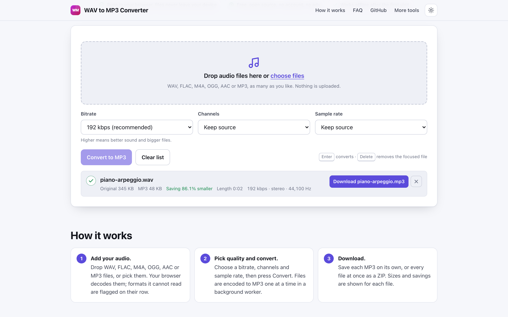
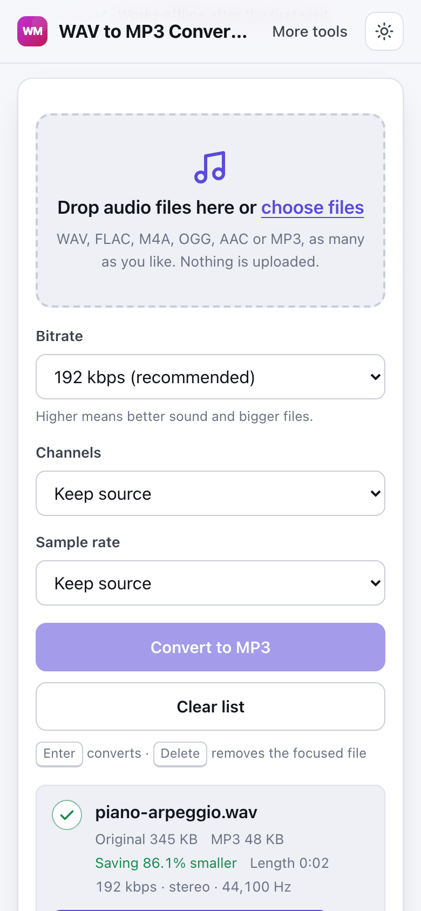

# WAV to MP3 Converter

> Convert WAV, FLAC, M4A and OGG files to MP3 in your browser with chosen bitrate, no upload.

**🌐 Use it now: [turhe123.github.io/wav-to-mp3-local](https://turhe123.github.io/wav-to-mp3-local/)** · free · open source · runs in your browser · works offline


## Why

This is a free, open-source alternative to CloudConvert WAV to MP3 (which uploads files to a server, limits the number of free conversions per day, and needs an account for more) and Convertio (which caps the free plan at 100 MB). Here your files never leave the device, there is no account, no ads and no daily limit, it works offline, and you can install it as an app.

## Screenshots

<p align="center"></p>

<p align="center"><em>WAV to MP3 Converter in the browser, light theme</em></p>

<p align="center"></p>

<p align="center"><em>WAV to MP3 Converter on a phone</em></p>

## Features

- Batch conversion: add as many files as you like by drag and drop or the file picker.
- Bitrate choice: 64, 96, 128, 160, 192 (default), 256 or 320 kbps.
- Channels: keep source (default), force stereo, or mix down to mono.
- Sample rate: keep source (read from the file header), 44,100 Hz or 48,000 Hz. Rates MP3 does not support are moved to the nearest supported one.
- Files are converted one at a time to keep memory use low. Encoding runs in a Web Worker with lamejs, so the page stays responsive.
- Per-file progress bar, with a time estimate for long files.
- Each result row shows the original size, the MP3 size, the saving (or growth) as a percentage, the duration and the output format, with its own Download button.
- Download all as a ZIP (stored, not recompressed) once two or more files are converted.
- Output names keep the base name with an `.mp3` extension, with a numeric suffix (`-2`, `-3`) on collisions. Unicode file names are preserved.
- Changing the settings lets you convert the same files again.
- Errors appear on the failing row (unsupported codec, empty audio, file too large) without stopping the others. Non-audio files are rejected with a visible message.
- Remove a single file or clear the list; a conversion in progress can be cancelled by removing its row.
- Keyboard friendly: Enter converts, Delete removes the focused row.
- Light and dark themes, responsive down to 390 px wide.
- Installable PWA that works offline after the first visit.

**Input formats:** WAV, FLAC, M4A, AAC, OGG/Opus, MP3, AIFF and WebM audio, as far as your browser can decode them. FLAC and M4A support varies by browser.

**Output format:** MP3 (`audio/mpeg`). Metadata tags are not edited or copied.

**Limits:** about 500 MB per file, because decoding expands audio in memory. There is no limit on the number of files or conversions.

## How to use

1. Open the page and drop your audio files on the drop zone, or choose them with the file picker.
2. Pick a bitrate, channels and sample rate (the defaults are 192 kbps and keep source).
3. Press **Convert to MP3** (or Enter). Files are encoded one after another.
4. Download each MP3 from its row, or press **Download all as ZIP** to get them together.

## Privacy

- Nothing is uploaded. Files are decoded and encoded locally in your browser tab.
- No cookies are set.
- Page views are counted anonymously with [GoatCounter](https://www.goatcounter.com/), which is cookieless and open source.
- A service worker caches the page so it works offline after the first visit.

## Run it locally

```sh
git clone https://github.com/turhe123/wav-to-mp3-local
cd wav-to-mp3-local
python3 -m http.server 4173
```

Then open http://127.0.0.1:4173/. There is no build step.

## Tests

```sh
npm i -D @playwright/test && npx playwright install chromium
npx playwright test
```

## Third-party code

Everything lives in `vendor/`, with its license file.

| Library | Version | License | Used for |
| --- | --- | --- | --- |
| [lamejs](https://github.com/zhuker/lamejs) | 1.2.1 | LGPL-3.0 | MP3 encoding |
| [fflate](https://github.com/101arrowz/fflate) | 0.8.2 | MIT | Building the ZIP download |

## Built with AI

WAV to MP3 Converter was written by [Claude Code](https://claude.com/claude-code) inside an automated pipeline, from a plain-English spec. No code or assets from any commercial product were used; it is a clean-room implementation of a feature set, not a copy.

What that means in practice:

- The full source is in this repo under the MIT license. Read it before you trust it with your files.
- Everything runs in your browser. It makes no network requests except an anonymous, cookieless page-view count (GoatCounter); your files never leave the device.
- The page is tested headless in Chromium (Playwright) before every release, but it has had less human review than hand-written software. Bug reports and pull requests are welcome.

## Support ❤️

If this saved you a trip to a paid converter, you can support the project on Ko-fi: https://ko-fi.com/leodavidai

## More free web tools

Browse the rest of the collection at https://turhe123.github.io/web-tools/.

Also: [free, open-source Mac apps](https://turhe123.github.io/mac-apps/) built the same way, native Swift, no accounts, no telemetry.

## License

MIT © Or Davidai Bachar
